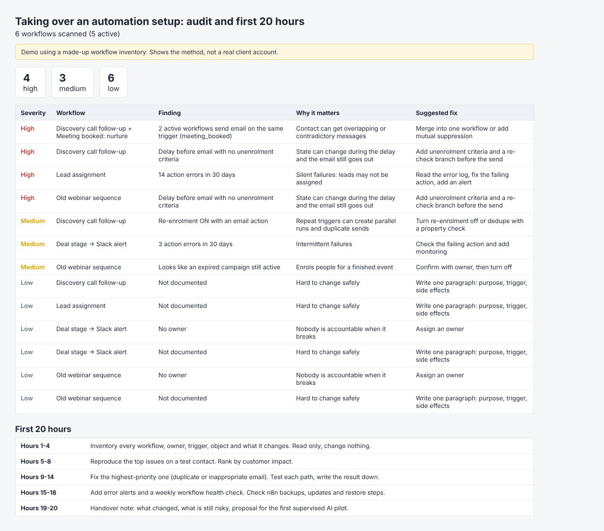

# Automation takeover audit + first 20 hours (demo)

Scans an exported workflow inventory for overlapping email triggers, delays without unenrolment criteria, re-enrolment with email actions, error-prone workflows, expired campaigns, missing owners and docs. Outputs a prioritised report and a first-20-hours plan.

> Demo on a made-up inventory. Shows the method, not a real client account.

Run: `python3 run.py` -> `output/audit.html`

