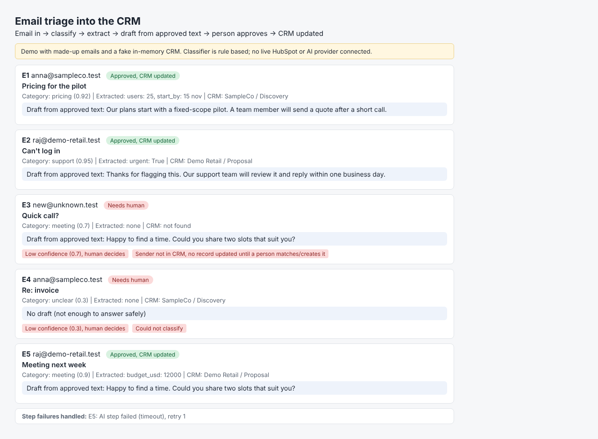

# CRM email triage with AI and human approval (demo)

Email -> classify -> extract fields -> draft from approved text only -> person approves -> CRM updated.
Handles wrong output (confidence gate), missing info (flags it, never invents), unknown sender, and a failed AI step (retry, then manual queue).

> Demo with made-up emails and an in-memory fake CRM. Rule-based classifier so it runs without an API key; `call_llm()` is the plug point. No live HubSpot or AI provider.

Run: `python3 run.py` -> `output/triage.html`, `crm_updates.json`

