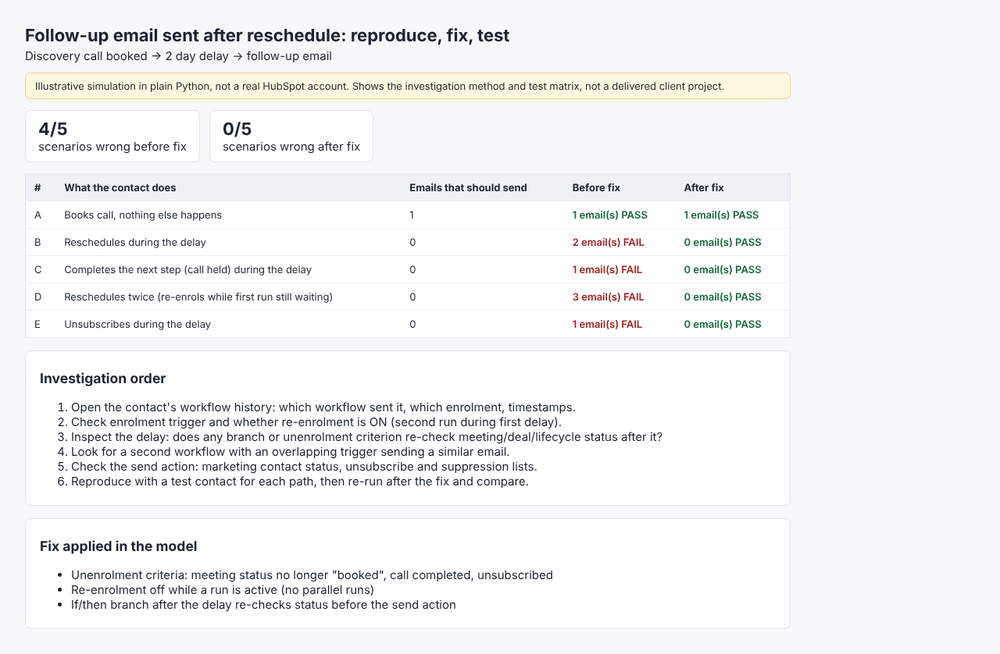

# Follow-up email after reschedule: reproduce, fix, test (illustrative)

Simulates the classic CRM bug: contact books a discovery call, enters a follow-up workflow, reschedules or completes the next step during the delay, and still gets the follow-up email.
Shows a before/after test matrix and the investigation order (workflow history, re-enrolment, unenrolment criteria, overlapping workflows, suppression).

> Illustrative simulation in plain Python. Not a real HubSpot account and not a delivered client project.

Run: `python3 run.py` -> `output/report.html`

