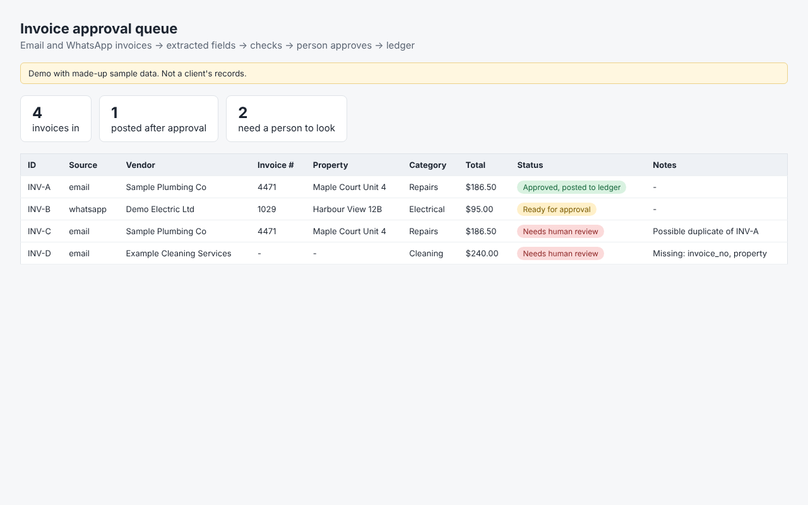

# Invoice approval workflow (demo)

Incoming invoices (email / WhatsApp text) -> fields extracted -> property + category assigned -> duplicate and missing-field checks -> bookkeeper approves -> ledger.
**Nothing reaches the ledger until a person approves it.**

> Demo with made-up sample data. Not a client's records. The extractor is rule based so it runs with no API key; `extract_with_llm()` is where ChatGPT/Gemini plugs in. In production the steps would be wired with n8n or Make, and the ledger step would call Buildium's API (not connected in this demo).

Run: `python3 run.py` (outputs `output/dashboard.html`, `queue.json`, `ledger.csv`).

