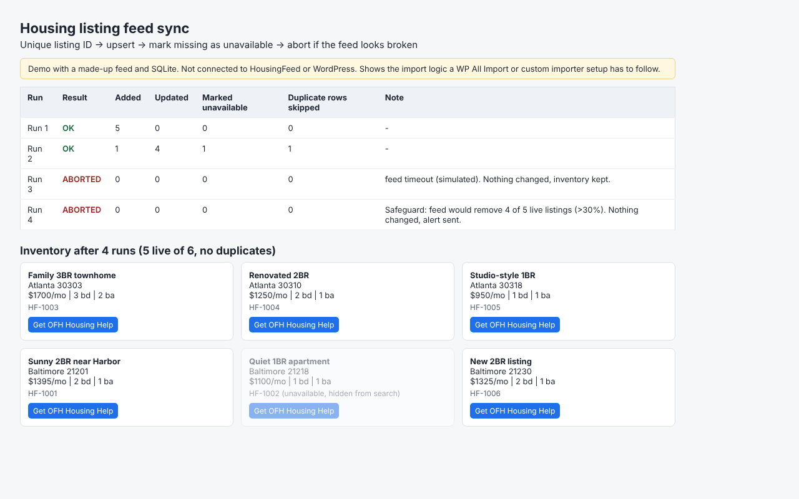

# Listing feed sync (demo)

Upsert on the feed's unique listing ID (no duplicates, updates in place), mark missing listings unavailable instead of deleting, and abort the run if the feed fails or would remove more than 30% of live inventory.

> Demo with a made-up feed and SQLite. Not connected to HousingFeed or WordPress. It shows the import rules a WP All Import or custom importer setup should follow.

Run: `python3 run.py` -> `output/report.html`, `runs.json`

