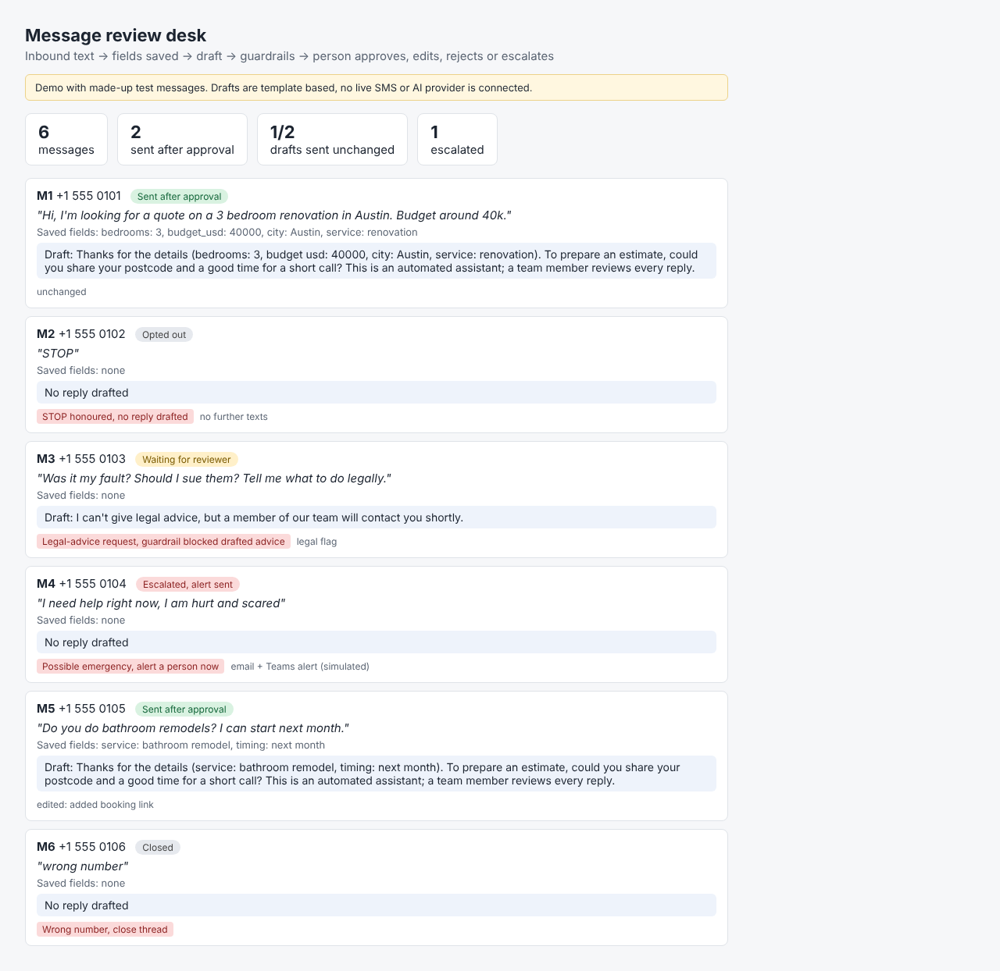

# Message intake + review desk (demo)

Inbound text -> structured fields saved -> draft reply -> guardrails -> human approves / edits / rejects / escalates.
STOP is honoured first, emergencies are escalated with no draft, legal-advice requests are blocked from drafting advice, wrong numbers are closed.

> Demo with made-up test messages. Drafts are template based; no SMS provider or LLM is connected. `draft_with_llm()` marks the LLM plug point. Metrics shown (e.g. drafts sent unchanged) mirror what a real review desk would track.

Run: `python3 run.py` (outputs `output/review_desk.html`, `log.json`).

