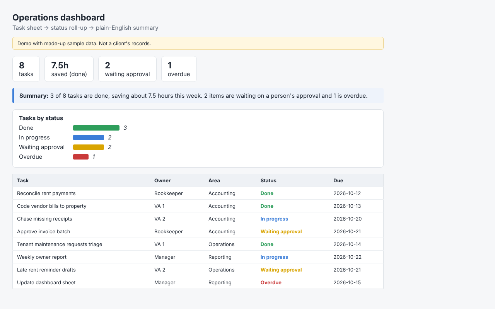

# Ops dashboard (demo)

Task sheet (CSV standing in for a Google Sheet) -> status roll-up -> hours saved -> plain-English summary.

> Demo with made-up sample data. The summary is computed from the data; `summary_text()` is where a Gemini/OpenAI call would write it.

Run: `python3 run.py` (outputs `output/dashboard.html`).

